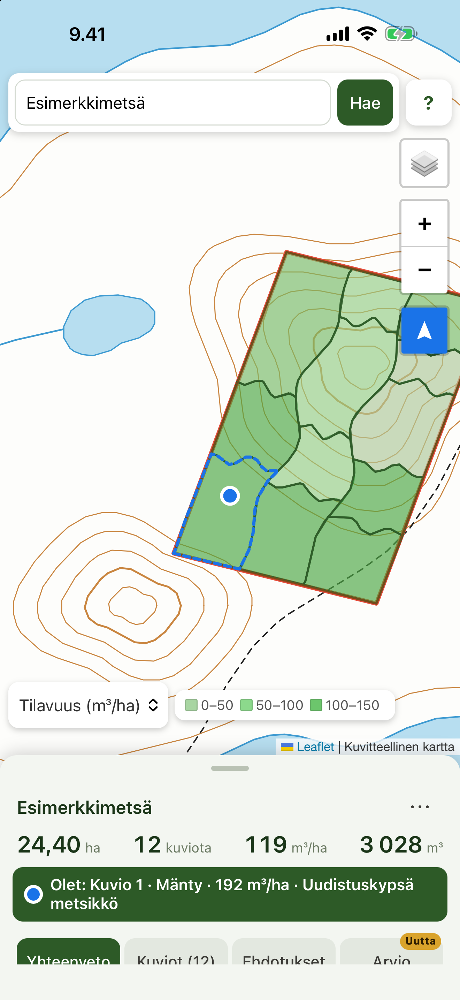
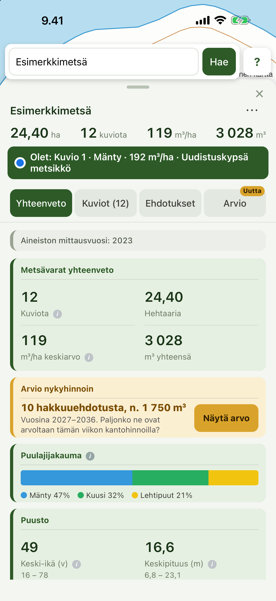
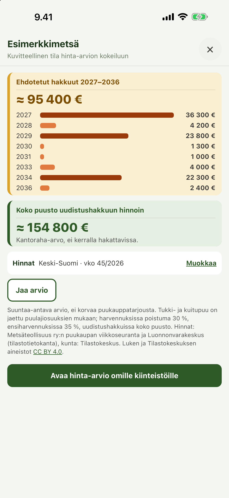

# Metsäinfo

**Suomen metsävaratiedot kartalla – iPhonelle, Androidille ja selaimeen.**

Näe minkä tahansa metsäkiinteistön puusto, kuviot ja hakkuuehdotukset kartalta muutamalla napautuksella. Metsäinfo kokoaa Metsäkeskuksen ja Maanmittauslaitoksen avoimen datan selkeäksi yhteenvedoksi metsänomistajalle, kiinteistöä harkitsevalle ja metsästä kiinnostuneelle.

<p>
  <a href="https://apps.apple.com/fi/app/id6832988855"></a>
  &nbsp;
  <a href="https://play.google.com/store/apps/details?id=fi.inetor.metsainfo"></a>
</p>

**[Avaa verkkoversio selaimessa →](https://trotor.github.io/metsainfo/)**

<p>
  
  
  
</p>

<sub>Kuvissa on kuvitteellinen Esimerkkimetsä kuvitteellisella saarella, ei oikeaa kiinteistöä.</sub>

---

## Mitä Metsäinfolla voi tehdä?

### Kiinteistö ja sen metsä yhdellä silmäyksellä
- **Kiinteistöhaku** – kirjoita kiinteistötunnus (esim. `999-1-1-1`) tai napauta kiinteistöä kartalla. Moniosaiset kiinteistöt kootaan yhteen.
- **Yhteenveto** – pinta-ala, kuvioiden määrä, puuston tilavuus (m³/ha ja yhteensä), puulajijakauma, keski-ikä, -pituus ja -läpimitta, kasvu, tukki- ja kuitupuu, kasvupaikat ja kehitysluokat.
- **Hakkuu- ja hoitoehdotukset** – Metsäkeskuksen ehdotukset vuosineen omalla välilehdellään. Lähivuosien hakkuut korostetaan.
- **Kuviot** – jokaisen metsikkökuvion tiedot listana. Napautus korostaa kuvion kartalla ja näyttää yksityiskohdat.
- **Mittausvuosi** – näet, minkä ikäistä aineisto on, ja sovellus varoittaa vanhentuneesta tiedosta.

### Kartta
- **Väritys** – kuviot värjätään tilavuuden, iän, pääpuulajin tai kehitysluokan mukaan.
- **Karttatasot** – peruskartta, taustakartta tai ilmakuva, sekä Metsälain erityisen tärkeät elinympäristöt ja metsänkäyttöilmoitukset (ilmoitetut hakkuut).
- **Oma sijainti** – näyttää paikkasi ja kulkusuuntasi sekä kertoo, millä kuviolla seisot. Sijainti pysyy laitteella.
- **Termien selitykset** – (i)-kuvake selittää metsäalan sanat selkokielellä.

### Jakaminen
- **Linkki** suoraan kiinteistöön, **CSV-taulukko** kuviotiedoista ja **tulostettava yhteenveto**.

### Puukaupan hinta-arvio (lisäosa sovelluksissa)
- Kertoo, paljonko kiinteistön ehdotetut hakkuut ovat arvoltaan **alueen tuoreilla kantohinnoilla** (Metsäteollisuus ry:n puukaupan viikkoseuranta ja Luonnonvarakeskuksen tilastot), sekä koko puuston arvon.
- Hinta-alue päätellään kiinteistön kunnasta. Omat hinnat voi syöttää esimerkiksi saamasi puukauppatarjouksen mukaan.
- **Jaa arvio** luo taulukon, jonka voi lähettää vaikkapa kuolinpesän osakkaille.
- **Kokeile esimerkkimetsällä** maksutta ennen ostoa. Kertaosto, ei tilausta – ajantasainen hinta näkyy sovelluksessa. Sama lisäosa iPhonella ja Androidilla.
- Arvio on suuntaa-antava eikä korvaa puukauppatarjousta.

### Tulossa – testiversiossa nyt
Seuraavia toimintoja kokeillaan testiversiossa. Ne voivat vielä muuttua ennen julkaisua.
- **Työkalut-valikko** – työkalut yhden napin takana nimineen ja kuvauksineen; päällä oleva työkalu näkyy kartan yläreunassa.
- **Kerro tästä paikasta** – napauta karttaa tai käytä sijaintia: kuvion tiedot maastossa ja metsävisa.
- **Etsi läheltä** – tietynlaiset metsät (esim. uudistuskypsä kuusikko) 1 km × 1 km alueelta.
- **Valitse kuvioita** – kokoa kuvioita valinnaksi myös kiinteistörajojen yli ja katso valinnan yhteenveto ja hinta-arvio, esimerkiksi kun harkitset kiinteistön osan ostamista.
- **Saavutettavuus** – kuvion arvioitu saavutettavuus 0–100: maaperän korjuukelpoisuus, metsäkuljetusmatka, märät kohdat (Luken kosteusindeksi) ja rinteet (MML:n korkeusmalli) kuljetusreitillä sekä tieyhteys (Digiroad), kartalla väreinä. [Miten indeksi lasketaan →](docs/saavutettavuusindeksi.md)
- **Huomioitavaa metsätöissä** – kiinteistön muinaisjäännökset, kulttuuriperintökohteet, luonnonsuojelu- ja Natura-alueet sekä Metsälain erityisen tärkeät elinympäristöt yhteenvedossa ja kartalla.
- **Retkeilykohteet** – laavut, kodat, tulentekopaikat, retkeilyreitit ja luontopolut kartalla (LIPAS).
- **Korkeusmalli** – laserkeilauksen vinovalaistu maastomalli taustakartaksi.
- **Suosikit ja omat muistiinpanot** kiinteistöille, kuvioille ja hauille.
- **Kielet** – suomi, ruotsi ja englanti.

---

## Kiinnostuitko yhteistyöstä tai kaipaatko ominaisuuksia?

Metsäinfon on tehnyt **[Inetor Oy](https://inetor.fi)**, joka kehittää mobiili-, kartta- ja tietosovelluksia avoimen datan ja tekoälyn päälle.

- Tarvitsetko Metsäinfoon toiminnon omaan käyttöösi tai organisaatiollesi?
- Haluatko vastaavan sovelluksen tai karttapalvelun omasta aineistostasi?
- Kiinnostaako metsätiedon tuominen omiin järjestelmiisi tai tekoälytyökaluihin?

**Ota yhteyttä: [inetoroy@gmail.com](mailto:inetoroy@gmail.com) · [inetor.fi](https://inetor.fi)**

Palautteet ja toiveet voi jättää myös [GitHub-issueina](https://github.com/trotor/metsainfo/issues).

---

## Metsätieto tekoälylle (MCP-palvelin)

Metsäinfon tiedot ovat käytettävissä tekoälytyökaluissa [MCP-palvelimen](https://modelcontextprotocol.io/) kautta. Kysy esimerkiksi:

- *"Hae metsävaratiedot kiinteistölle 999-1-1-1"*
- *"Paljonko tukkipuuta on kiinteistöllä 999-1-1-1?"*

| Työkalu | Kuvaus |
|---------|--------|
| `hae_metsavaratieto(kiinteistotunnus)` | Ihmisluettava yhteenveto: pinta-ala, tilavuus, puulajit, hakkuuehdotukset |
| `hae_raakadata(kiinteistotunnus)` | JSON-raakadata: kuviokohtaiset mittaustiedot tekoälymallin analysoitavaksi |

Kiinteistötunnus voi olla muodossa `999-1-1-1` tai `99900100010001`.

**Claude Code:** palvelin on valmiiksi määritelty `.mcp.json`-tiedostossa ja käynnistyy, kun avaat projektin [Claude Codessa](https://claude.ai/code).

**Claude Desktop:** lisää `claude_desktop_config.json`-tiedostoon (vaatii [uv](https://docs.astral.sh/uv/):n):

```json
{
  "mcpServers": {
    "metsainfo": {
      "command": "uv",
      "args": ["run", "--with", "fastmcp", "--with", "certifi", "fastmcp", "run", "/polku/metsainfo/mcp-server/server.py"]
    }
  }
}
```

---

## Tietosuoja

Metsäinfo ei kerää eikä jaa henkilötietoja. Sijainti käsitellään vain laitteella, ja karttapyynnöt sisältävät vain katsotun alueen. Lue [tietosuojaseloste](https://trotor.github.io/metsainfo/tietosuoja.html).

## Datalähteet

| Data | Lähde |
|------|-------|
| Metsävaratiedot, luontokohteet, metsänkäyttöilmoitukset, korjuukelpoisuus | [Suomen metsäkeskus](https://www.metsakeskus.fi/fi/avoin-metsa-ja-luontotieto) (CC BY 4.0) |
| Kiinteistörajat | [Maanmittauslaitos](https://www.maanmittauslaitos.fi/) (INSPIRE WFS) |
| Taustakartat | [Kapsi](https://kartat.kapsi.fi/) / [MML](https://www.maanmittauslaitos.fi/) |
| Kantohinnat | Metsäteollisuus ry:n puukaupan viikkoseuranta, [Luonnonvarakeskus](https://www.luke.fi/) (CC BY 4.0) |
| Tieverkko (testiversio) | [Väylävirasto, Digiroad](https://vayla.fi/) (CC BY 4.0) |
| Kosteusindeksi ja korkeusmalli (testiversio) | [Luonnonvarakeskus](https://www.luke.fi/), [Maanmittauslaitos](https://www.maanmittauslaitos.fi/), jakelu [CSC Paituli](https://paituli.csc.fi/) (CC BY 4.0) |
| Muinaisjäännökset ja kulttuuriperintö (testiversio) | [Museovirasto](https://www.museovirasto.fi/) (CC BY 4.0) |
| Suojelu-, Natura- ja erämaa-alueet (testiversio) | [Suomen ympäristökeskus](https://www.syke.fi/) (CC BY 4.0) |
| Retkeilykohteet (testiversio) | [LIPAS, Jyväskylän yliopisto](https://www.lipas.fi/) (CC BY 4.0) |

---

## Kehittäjille

Verkkosovellus toimii kokonaan selaimessa ilman omaa palvelinta. iOS- ja Android-sovellukset on rakennettu samasta koodista [Capacitorilla](https://capacitorjs.com/).

- **Leaflet**, **Proj4js** ja **Proj4Leaflet** – kartta suoraan Suomen ETRS-TM35FIN-koordinaatistossa (EPSG:3067)
- **Vite** ja **Vitest** – build ja yksikkötestit
- **Capacitor 8** – iOS (StoreKit 2) ja Android (Play Billing)
- **FastMCP** – MCP-palvelin (`mcp-server/`)

```bash
git clone git@github.com:trotor/metsainfo.git
cd metsainfo
npm install
npm run dev        # kehityspalvelin, oletuksena http://localhost:5173
npm test           # yksikkötestit
npm run build      # tuotantobuild dist/-hakemistoon
```

Arkkitehtuuri, laajennuspisteet ja kehityskäytännöt: [CLAUDE.md](CLAUDE.md). Sovellus on kehitetty [Claude Code](https://claude.ai/code) -työkalulla; kehitysprosessista ja esimerkkiprompteista kertoo [CLAUDE-HOWTO.md](CLAUDE-HOWTO.md).

## Versiot

Verkkoversio, App Store ja Google Play käyttävät samaa versionumeroa. Muutokset näkyvät sovelluksen käyttöohjeen kohdassa *Uutta versiossa*.

- **4.0.x** (marraskuu 2026) – sovellukset App Storeen ja Google Playhin, puukaupan hinta-arvio, värikoodatut tietoruudut
- **3.x** – oma sijainti ja kulkusuunta, mobiilikäyttöliittymä, metsänkäyttöilmoitukset
- **2.x** – käyttöohje, MCP-palvelin, ES-moduulit
- **1.x** – ensimmäinen julkaisu, kiinteistöhaku, väritykset, luontokohteet, CSV ja tulostus

## Lisenssi ja tekijä

Lähdekoodi: MIT. © Tero Rönkkö / [Inetor Oy](https://inetor.fi).

<sub>Apple ja Apple-logo ovat Apple Inc.:n Yhdysvalloissa ja muissa maissa rekisteröityjä tavaramerkkejä. App Store on Apple Inc.:n palvelumerkki. Google Play ja Google Play -logo ovat Google LLC:n tavaramerkkejä.</sub>
